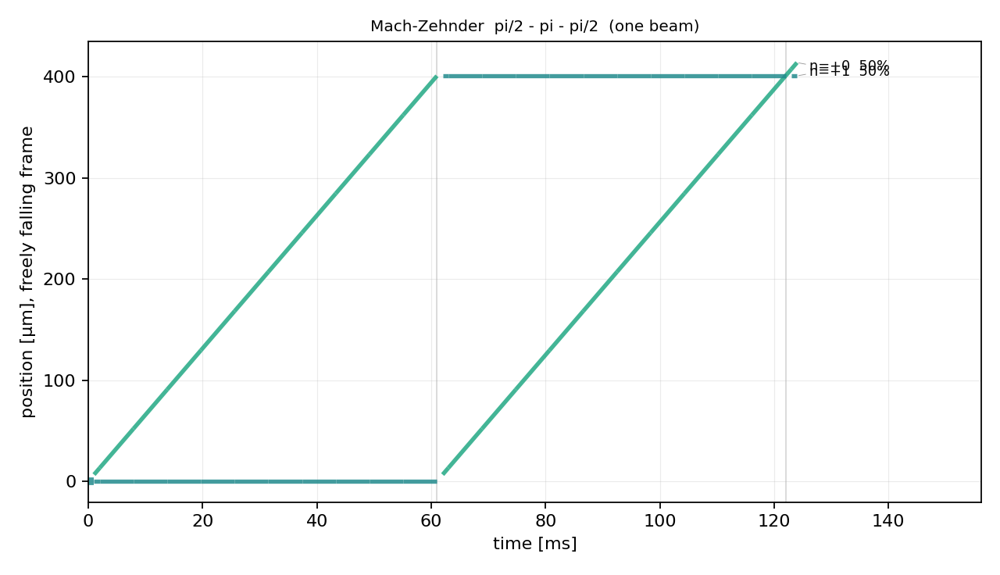
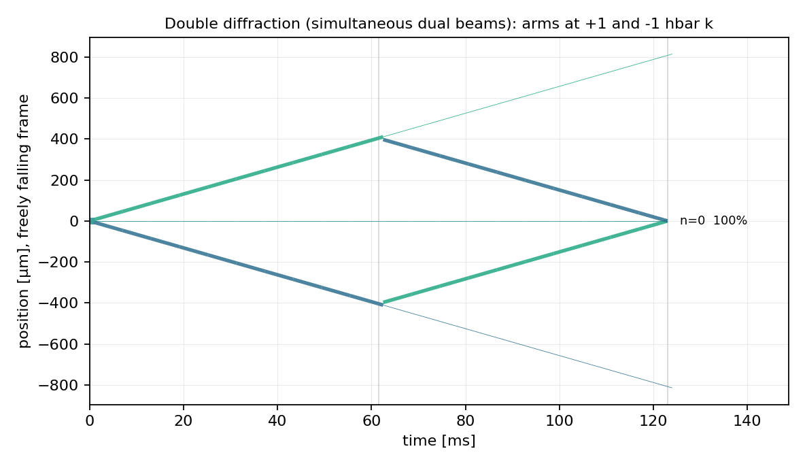
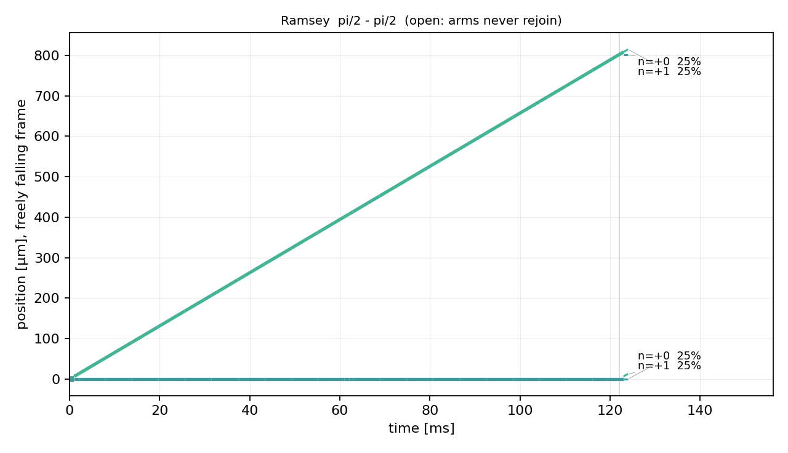

# AIF_SIM

**A differentiable simulator for pulse-sequence design in light-pulse atom interferometry.**

*Shubhang Dadhich, University of Tübingen. Research prototype. Page last updated 2026-10-15.*
*Source code is in a private repository; access for reviewers is available on request (contact below).*

---

## What it is

Atom interferometers measure acceleration, rotation and gravity gradients through the phase between
atomic paths that are split, redirected and recombined by laser pulses. The sensitivity of an
instrument depends on how the pulse sequence is built: the number of pulses, their timing, area, phase
and detuning, and how much momentum each one transfers. Known schemes (Mach–Zehnder, multi-loop,
double diffraction, gravity-gradient compensation) were derived analytically, one at a time.

AIF_SIM treats the whole pulse sequence as a set of continuous parameters and makes every output
differentiable with respect to all of them (written in JAX, float64). That allows gradient-based search
over sequences and over which pulses are used at all, instead of evaluating one hand-built scheme at a time.

## The model

- **State space.** Atoms on a truncated momentum ladder, |n, g⟩ and |n, e⟩ with p = p₀ + n·ħk, |n| ≤ N,
  for a single-photon clock transition. The simulation runs in a frame rotating at the atomic frequency,
  so no rest-energy phase enters the arithmetic.
- **Sequence.** K time slots. Each slot has a gap and an "up" and a "down" sub-pulse. Each sub-pulse has an
  area, a laser phase and a detuning. Area zero means the pulse is off, so topology is a continuous variable.
  A second module, `dual`, adds simultaneous dual-beam pulses.
- **Propagation.** Finite pulse duration and off-resonant coupling are included; each pulse is an exact
  propagator, not an idealised rotation. Acceleration enters as the laser phase k·a·t²/2 at each pulse.
- **Ensemble.** Contrast comes from averaging over the atomic velocity distribution (Doppler dephasing),
  not from an imposed factor.
- **Outputs.** Port populations, contrast and the classical Fisher information on the acceleration, all
  differentiable with respect to every sequence parameter. Space-time diagrams of the atomic branches can be drawn from any sequence.

*A Mach–Zehnder sequence. A scheme works if its branches rejoin at the right edge.*

*Double diffraction with simultaneous dual beams: arms at +1 and −1 ħk rejoin in a single port.*

*A Ramsey sequence for contrast: the arms never rejoin, so there is no signal.*

## Validation

Every item below was run against the current code; the checks are in the repository's validation suite.

| check | result |
|---|---|
| one pulse vs the generalised Rabi formula | agrees to ≲ 1e-14 |
| Mach–Zehnder scale factor vs k·T_eff² | relative deviation 7e-7 |
| zero pulse area vs free evolution | 1.1e-16 |
| automatic differentiation vs central finite differences | worst relative difference ≈ 3e-10 |
| fast two-level propagator vs matrix exponential (nonzero start time) | 2e-15 |
| contrast and Fisher information vs velocity width | fall together, as expected |

**Rediscovery of published results.** Four known results were recovered from objectives that did not contain them:

1. Compensation of the gravity-gradient phase with a modified mirror wavevector, Δk = Γ·k·T²/2 (Roura 2017), found in one Newton step.
2. Double-loop timings that cancel uniform acceleration (α = 1) and a linear gravity gradient (α = (√5 − 1)/2) (Dimopoulos et al., PRD 78, 122002, 2008).
3. Triple-loop timings (2 − √2)/4 and 1 − (2 − √2)/4 for two simultaneous nulling conditions.
4. The double-diffraction scale factor of exactly 2 × k·T_eff² with simultaneous beams.

## Search results so far

At K = 5, all 1,024 on/off patterns were optimised from 32 random starts each, and a joint continuous-topology optimiser was run from 32,768 starts. The best designs recover a known mechanism (a symmetric ±ħk geometry with doubled momentum separation), not a new scheme. 32 random starts do not reliably reach a topology's optimum, so per-topology values are lower bounds.

## Computational profile

Measured on one NVIDIA A100-PCIE-40GB (ML Cloud, Tübingen), float64, JAX 0.11.2:

| quantity | measured |
|---|---|
| gradient throughput, K = 12 | 20,000–26,000 gradient evaluations/s, depending on batch size (256–4096) |
| GPU memory, K = 12 | 2.0 GB at batch 1,024; 8.1 GB at batch 4,096 |
| host memory | below 3 GiB |
| full K = 5 enumeration (1,024 topologies × 32 starts) | about 5 minutes at 0.0008 recoil velocities (1.0 × 10⁷ gradient evaluations); about 30 minutes of summed shard time at 0.002 |
| joint optimiser, 32,768 starts, K = 5 | about 6.5 minutes at 0.0008 (1.8 × 10⁷ gradient evaluations); about 18 minutes at 0.002 |

The workload has three independent axes: topologies, random restarts and velocity-quadrature nodes. There
is no communication between them, so it maps onto batching and sharding. The cost grows quickly with K: an
exhaustive K = 12 enumeration (2²⁴ patterns × 32 starts) projects to about 10¹² gradient evaluations; this specific run is not currently planned.

## Intended use of a development allocation

Port the code to the target GPU system, validate it against the checks above, and implement batched
and sharded execution across the three axes. Then measure scaling on 1 to many GPUs and write down what
it costs to certify per-topology optima at larger K. The deliverable is a documented scaling study.

## Limitations

- **No position.** The model has no spatial wavefunction, so gravity gradients, rotations, wavefront curvature
  and beam profiles are invisible to the search. Spatial separation is penalised only through velocity dephasing.
  A position-aware layer is the intended next step.
- **No per-pulse costs or noise budget yet.** Spontaneous emission, pulse-area and phase errors and laser
  noise are not modelled in the search objective, so gains from adding pulses are overstated.
- **Optimiser certification.** Per-topology values are lower bounds, not proven optima (see above).
- **Hardware portability.** The best value of a many-start search reproduced exactly on two different A100
  nodes, but individual starts can differ between a CPU and a GPU, so only best-of-many values should be quoted.

## Access and contact

The source code is in a private repository. Reviewers can be given read access: <contact email>.
